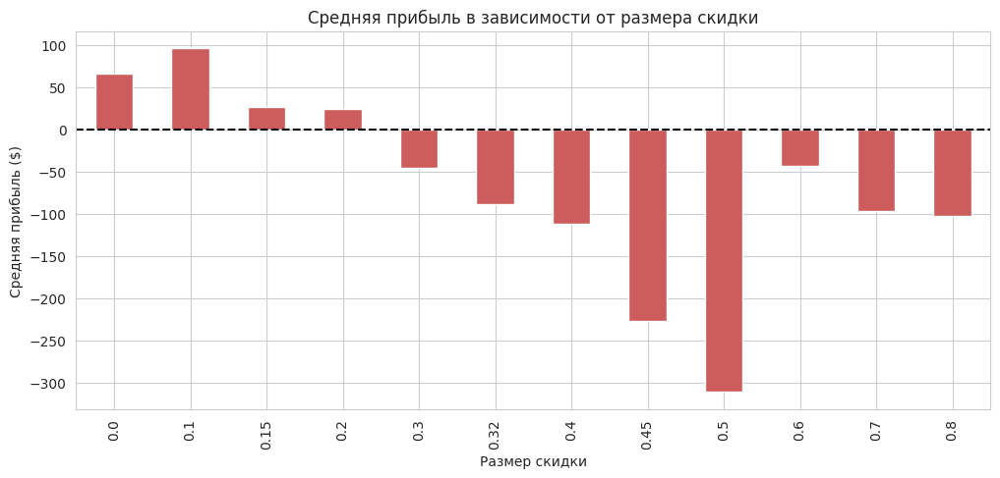
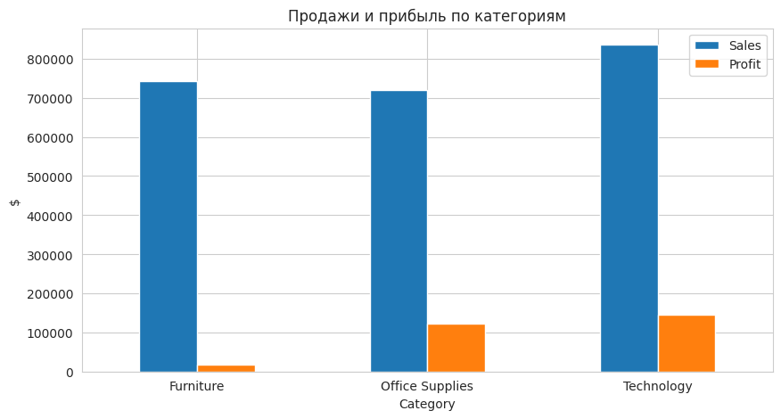
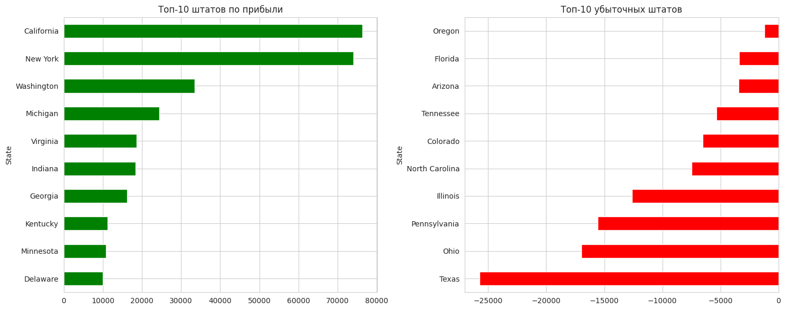
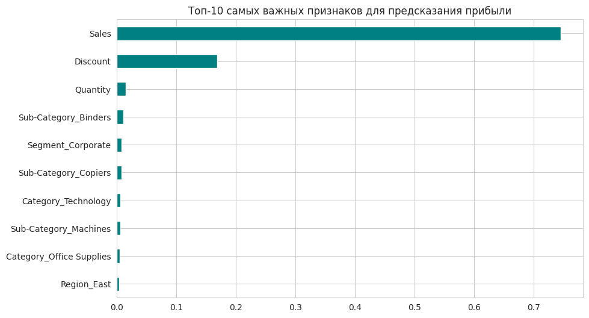

# Анализ розничных продаж (Superstore)

## 📌 О проекте
Данный проект представляет собой разведочный анализ данных (EDA) и построение модели машинного обучения для выявления факторов, влияющих на прибыль розничной сети. 

**Главная цель:** найти точки роста и причины убытков, а также сформулировать бизнес-рекомендации по оптимизации политики скидок и ассортимента.

## 📊 Данные
В основе проекта лежит датасет [Superstore](https://www.kaggle.com/datasets/vivek468/superstore-dataset-final) (розничные продажи в США). 
- **Объем:** ~9900 строк, 21 колонка.
- **Период:** 2011–2014 гг.
- **Ключевые метрики:** Sales (продажи), Profit (прибыль), Discount (скидка).

## 🛠 Стек технологий
- **Язык:** Python
- **Библиотеки:** Pandas, NumPy, Matplotlib, Seaborn, Scikit-learn
- **Среда:** Google Colab

## 🔍 Ключевые инсайты (EDA)

### 1. Скидки — главный убийца прибыли
Средняя скидка в убыточных сделках составляет 48%, в то время как в прибыльных — всего 8%. При скидке выше 20% средняя сделка уходит в минус. 

### 2. Категория Furniture — балласт
При огромном объеме продаж (около $740 тыс.) категория Furniture приносит минимальную прибыль. Маржинальность составляет всего 1.3%. Подкатегории *Tables* и *Bookcases* приносят прямой убыток.

### 3. Географические точки роста
Калифорния и Нью-Йорк приносят более $70 тыс. прибыли каждый. В то же время Техас, Огайо и Пенсильвания генерируют убытки от -$15 тыс. до -$25 тыс.

### 4. Сезонность
Наблюдается четкая сезонность: пики продаж приходятся на сентябрь и ноябрь (праздничный сезон и конец кварталов), а также на март. Самый низкий спрос — в феврале.

## 🤖 Машинное обучение
Для предсказания прибыли была обучена модель **Random Forest Regressor**. 
- **MAE:** $25.10 (средняя абсолютная ошибка).
- **R²:** 0.014 (модель показала, что прибыль отдельной сделки сильно зависит от выбросов и скрытых факторов, которых нет в датасете).

Однако **анализ важности признаков** дал потрясающий результат: признаки **Sales** и **Discount** объясняют более 90% важности модели. Остальные факторы (категории, регионы) практически не влияют на итоговую прибыль.

## 💡 Бизнес-рекомендации
1. **Ограничить скидки:** ввести жесткий лимит на скидку в 20% для всех менеджеров. Текущая политика ведет к прямым финансовым потерям.
2. **Пересмотреть ассортимент:** повысить цены на столы и книжные шкафы (Tables, Bookcases) или отказаться от их продажи, так как они убыточны.
3. **Логистика:** проанализировать затраты на доставку в убыточные штаты (Техас, Огайо, Пенсильвания), возможно, транспортные расходы съедают всю маржу.
4. **Маркетинг:** усилить рекламные кампании к пиковым месяцам (сентябрь, ноябрь), а в феврале — проводить распродажи для очистки складов.

## 🚀 Как запустить проект
1. Скачайте файл `superstore.csv` и блокнот `analysis.ipynb` из этого репозитория.
2. Откройте блокнот в Jupyter Notebook или Google Colab.
3. Загрузите файл `superstore.csv` в рабочую директорию.
4. Запустите все ячейки (`Kernel -> Restart & Run All`).
